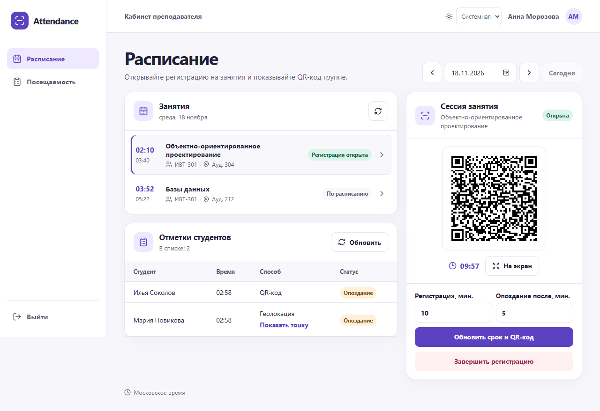
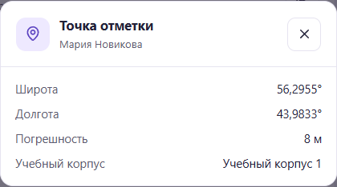
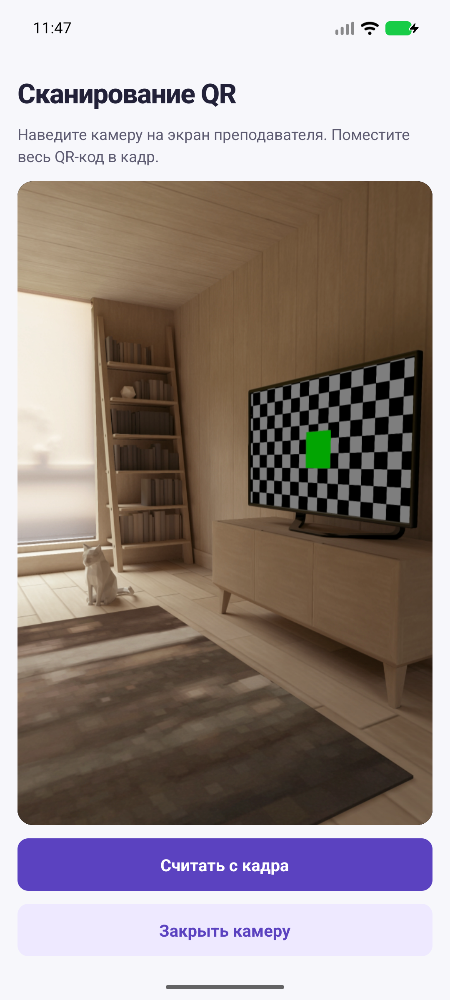
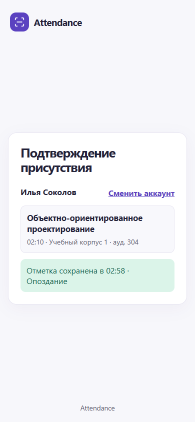

# Attendance

Учебная система учёта посещаемости. Преподаватель открывает регистрацию на занятие и показывает QR-код. Студент отмечается в приложении по QR-коду или геолокации. Сервер сверяет расписание, время регистрации и группу, сохраняет одну отметку на занятие и определяет статус опоздания.

## Быстрый запуск

Понадобятся Docker с Compose и Python 3.13. Команды выполняются в корне репозитория.

```sh
python ops/init_env.py
docker compose build app
docker compose up --no-build -d --wait
docker compose run --rm --no-deps seed
```

- Кабинет преподавателя — [https://localhost](https://localhost). Swagger UI — [https://localhost/docs](https://localhost/docs).
- Логин преподавателя `teacher`. Логины студентов `student`, `student2` и `other`. Демонстрационный пароль находится в поле `DEMO_PASSWORD` локального файла `.env`.
- Для студента `other` задана другая учебная группа. Учебная геозона находится у точки `56.2955, 43.9833`, радиус 120 м, максимальная допустимая погрешность 50 м.

Для доступа с телефона и настройки доверия к HTTPS-сертификату см. [развёртывание](docs/deployment.md). Учебные занятия сегодняшнего дня создаются при первом запуске `seed` за день. Пара «Объектно-ориентированное проектирование» доступна для открытия сразу после загрузки.

## Работа в системе

1. Преподаватель выбирает занятие, задаёт время регистрации и границу опоздания, затем нажимает «Открыть регистрацию». Кнопка «На экран» увеличивает код для проектора.
2. Студент сканирует QR обычной камерой телефона или в мобильном приложении. На странице подтверждения он входит под своей учётной записью, сверяет имя и занятие, нажимает «Подтвердить присутствие» и разрешает геолокацию. В приложении также можно выбрать «Отметиться по геолокации» у открытого занятия. Результат сохраняется во вкладке «История».
3. Преподаватель нажимает «Обновить» в списке. При необходимости он меняет срок регистрации или завершает её досрочно. Сохранённые отметки доступны в разделе «Посещаемость».
4. У новой геоотметки преподаватель нажимает «Показать точку». Откроются широта, долгота и погрешность в метрах. Они хранятся вместе с отметкой. Для старых отметок, сделанных до обновления, точка недоступна.

Если QR не считывается автоматически, наведите камеру на весь код и нажмите «Считать с кадра» в мобильном приложении.

Журнал показывает имя студента из учётной записи, под которой подтверждено присутствие. Пересылка QR сама по себе не создаёт отметку. Система также проверяет группу и геозону. Учётные данные следует использовать индивидуально. Проверка геозоны не заменяет проверку личности при передаче аккаунта или подмене координат.

## Скриншоты

### Кабинет преподавателя





### Приложение студента



### Подтверждение в браузере телефона



## Материалы проекта

- [Архитектура и модель данных](docs/architecture.md)
- [Контракт REST API](docs/api.md)
- [Исходники диаграмм UML](docs/attendance.puml)
- [Развёртывание, мобильная сборка и восстановление](docs/deployment.md)
- [Автоматические проверки](docs/verification.md)
