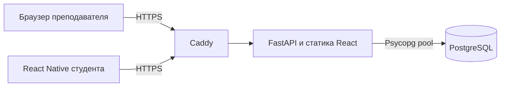
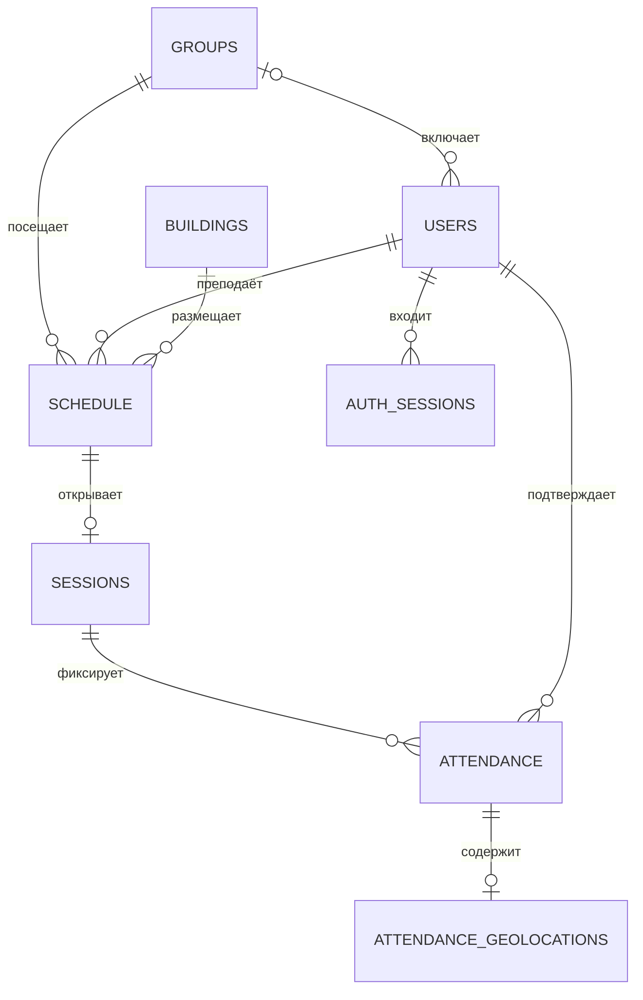

# Архитектура Attendance

## Решения первой версии

- FastAPI работает как модульный монолит. Аутентификация, сессии и отметки имеют отдельные модули. Одна база и короткие транзакции упрощают согласование отметки с закрытием сессии.
- Для учебной демонстрации используются локальные учётные записи и расписание. Интеграция с порталом вуза потребует отдельного контракта идентификации и расписания.
- QR содержит HTTPS-ссылку на страницу подтверждения. Подписанный код передаётся в фрагменте ссылки. После входа студент видит своё имя и данные занятия, затем подтверждает присутствие. Сервер получает идентификатор студента из авторизованной сессии и повторно проверяет QR, расписание и геозону при сохранении. Координаты для QR используются только при проверке.
- Студент состоит в одной учебной группе. Каждое занятие принадлежит преподавателю и группе, проходит в аудитории указанного корпуса и имеет одну сессию. Закрытая вручную сессия окончательна.
- Сессия открывается с начала занятия до его конца. Срок регистрации ограничен окончанием занятия. Преподаватель может продлить истёкшую регистрацию до конца занятия или закрыть её досрочно. Изменение срока или границы опоздания обновляет QR и отзывает предыдущий код.
- Геозона соответствует корпусу. Принимается точка, чей круг горизонтальной погрешности целиком внутри зоны. Для успешной геоотметки координаты и погрешность сохраняются в отдельной связанной таблице на весь срок хранения отметки. Только преподаватель этого занятия может получить точку. Клиентские координаты и переданный QR сами по себе не доказывают физическое присутствие.
- Занятие считается посещённым вовремя до границы опоздания включительно. Изменение границы действует на будущие отметки. Сервер берёт UTC-время PostgreSQL после захвата блокировки сессии.
- Доступ к сессии проверяется по преподавателю или группе. Студенческие ответы содержат данные только этого студента. При допустимом доступе повтор возвращает исходную отметку. PostgreSQL обеспечивает уникальность по паре сессия–студент, а уникальная связь занятия и сессии распространяет её на занятие.
- Блокировки `FOR SHARE` позволяют вести параллельную регистрацию разных студентов. Изменение сессии использует `FOR UPDATE`. Вставка `ON CONFLICT DO NOTHING` и повторное чтение в READ COMMITTED обрабатывают гонку одинаковых запросов.
- Веб-клиент держит access JWT в памяти, refresh JWT в HttpOnly cookie. Мобильный клиент хранит refresh JWT в системном защищённом хранилище. Сервер ротирует refresh JWT при каждом использовании и отзывает сессию входа при выходе. QR подписывается отдельным ключом.

## Модель данных

